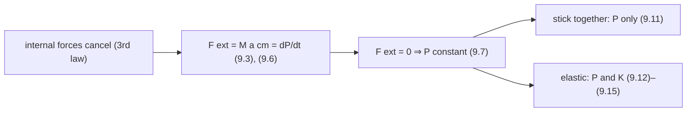
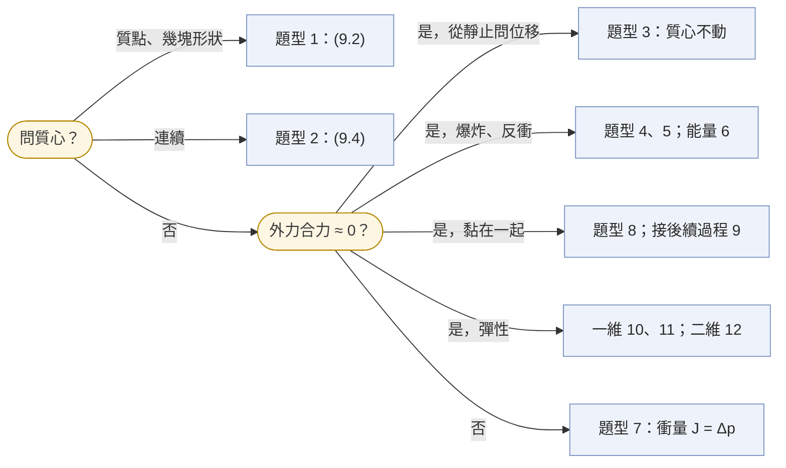

%% unit-summary v1.4 · Wolfson, Essential University Physics 4e (Global Edition), Vol. 1, Ch. 9, pp. 166–190; outside exams from KSU and SIU · 2026-10-21 %%

# Chapter 9 Systems of Particles — a system moves like one particle at its center of mass; momentum (force × time, as energy is force × distance) is conserved when no net external force acts

## 9.1 Center of Mass

圖：多質點系統，系統邊界內畫成對的內力、邊界外畫外力；標 $m_{i}$、$\vec{r}_{i}$、$\vec{F}_{\mathrm{ext}}$

Derivation, Newton's second law for each particle:

$$
\begin{aligned}
\vec{F}_{i} = m_{i}\frac{d^{2}\vec{r}_{i}}{dt^{2}} \implies \vec{F}_{\mathrm{total}} &= \sum \vec{F}_{i} = \frac{d^{2}\left(\sum m_{i}\vec{r}_{i}\right)}{dt^{2}} \\
&= M\frac{d^{2}}{dt^{2}}\left(\frac{\sum m_{i}\vec{r}_{i}}{M}\right) \quad (9.1)
\end{aligned}
$$

$$
\vec{r}_{\mathrm{cm}} = \frac{\sum m_{i}\vec{r}_{i}}{M}, \qquad M = \sum m_{i} \qquad \text{(center of mass)} \quad (9.2)
$$

the positions averaged with the masses as weights; one equation per component, $x_{\mathrm{cm}} = \sum m_{i}x_{i}/M$, $y_{\mathrm{cm}}$, $z_{\mathrm{cm}}$

$\vec{F}_{\mathrm{total}} = \sum \vec{F}_{\mathrm{ext}} + \sum \vec{F}_{\mathrm{int}}$ and $\sum \vec{F}_{\mathrm{int}} = \vec{0}$ (Newton's third law: internal forces cancel in pairs) ⇒

$$
\vec{F}_{\mathrm{net\,ext}} = M\vec{a}_{\mathrm{cm}} = M\frac{d^{2}\vec{r}_{\mathrm{cm}}}{dt^{2}} \quad (9.3)
$$

for its overall motion the system acts as if all its mass were at the center of mass

> - origin at one particle: its term drops out (Example 9.1); the physical location of the CM does not depend on the origin (Exercise 12)
> - exploit symmetry: the CM lies on every symmetry axis (Example 9.2)
> - two particles a distance $d$ apart: the CM is $\dfrac{m_{2}}{m_{1} + m_{2}}d$ from $m_{1}$, nearer the heavier one (derived)

### Continuous Distributions of Matter

圖：連續物體中的一塊質量元素與從原點畫的位置向量；三角形機翼取寬 $dx$ 的垂直細條；標 $dm$、$\vec{r}$、$dx$、$h = (w/L)x$

$$
\vec{r}_{\mathrm{cm}} = \lim_{\Delta m_{i} \to 0}\frac{\sum \Delta m_{i}\vec{r}_{i}}{M} = \frac{\int \vec{r}\,dm}{M} \quad (9.4)
$$

center of mass of continuous matter: three integrals, one per component, over the whole object

**Tactics 9.1 Setting up an integral**: shape of the mass element (use symmetry; one dimension infinitesimal, a strip of width $dx$) → its length, area, or volume → ratio $\dfrac{dm}{M} = \dfrac{dA}{A}$ → solve for $dm$ and integrate

> given a density (per length, area, or volume): $dm$ = density × $dx$ ($dA$, $dV$) replaces the ratio step

| uniform object | center of mass | source |
| --- | --- | --- |
| triangle, apex to base $L$ | $\tfrac{2}{3}L$ from the apex | Example 9.3 |
| semicircular wire, radius $R$ | $\dfrac{2R}{\pi}$ from the center | (derived), Problem 86 |
| solid cone, height $h$ | $\tfrac{1}{4}h$ above the base | (derived), Problem 47 |
| solid hemisphere, radius $R$ | $\tfrac{3}{8}R$ above the flat face | (derived), Problem 55 |
| slice of radius $R$, angle $\theta$ | $\dfrac{4R\sin(\theta/2)}{3\theta}$ from the tip | (derived), Problem 87 |

> - composite object: each part becomes a point mass at its own CM (Fig. 9.5); a missing part: $M_{\mathrm{rest}}\vec{r}_{\mathrm{rest}} = M\vec{r}_{\mathrm{whole}} - m_{\mathrm{gone}}\vec{r}_{\mathrm{gone}}$ (derived)
> - the CM need not lie within the object: semicircular wire (Fig. 9.6), high jumper (Fig. 9.7)
> - semicircular wire: the CM is the uppermost of the marked points (GOT IT 9.1): higher horizontal strips hold more wire

### Motion of the Center of Mass

| net external force | motion of the CM |
| --- | --- |
| gravity only | projectile path, whatever the parts do (dancer, high jumper) |
| zero | $\vec{v}_{\mathrm{cm}}$ constant |
| zero, system at rest | the CM stays put |

圖：無摩擦軌道上的車廂與大象，畫走之前、之後兩張，質心位置是一條不動的虛線；標 $m_{\mathrm{J}}$、$m_{\mathrm{c}}$、$x_{\mathrm{Ji}}$、$x_{\mathrm{Jf}}$、$x_{\mathrm{ci}}$、$x_{\mathrm{cf}}$

$x_{\mathrm{cm\,i}} = x_{\mathrm{cm\,f}}$ ⇒ $\sum m_{i}\Delta x_{i} = 0$, with displacements relative to the ground

> - walking a distance $d$ relative to a free platform of mass $M$: the platform moves $\dfrac{m}{m + M}d$ backward and the walker $\dfrac{M}{m + M}d$ forward (Example 9.4)
> - masses enter only as ratios: no unit conversion

## 9.2 Momentum

$\vec{P} = \sum m_{i}\vec{v}_{i} = \sum m_{i}\dfrac{d\vec{r}_{i}}{dt} = \dfrac{d}{dt}\sum m_{i}\vec{r}_{i} = \dfrac{d}{dt}\left(M\vec{r}_{\mathrm{cm}}\right)$ ⇒

$$
\vec{P} = M\frac{d\vec{r}_{\mathrm{cm}}}{dt} = M\vec{v}_{\mathrm{cm}} \quad (9.5)
$$

**$M$ constant**; the system's momentum is that of one particle of mass $M$ moving with the CM

$$
\vec{F}_{\mathrm{net\,ext}} = \frac{d\vec{P}}{dt} \quad (9.6)
$$

Newton's second law for a system: only a net external force changes $\vec{P}$; internal forces only pass momentum among the parts

| | energy (Ch. 7) | momentum |
| --- | --- | --- |
| total changes only by | work done by external forces (7.8) | net external force (9.6) |
| inside the system | transformed and transferred | transferred among the particles |
| constant when | no external work | $\vec{F}_{\mathrm{net\,ext}} = \vec{0}$ |

### Conservation of Momentum

$$
\vec{P} = \text{constant} \qquad \text{(conservation of linear momentum)} \quad (9.7)
$$

> - **only when the net external force on the system is zero**
> - a vector law: a component of $\vec{P}$ is constant when the external force has no component along it (derived from (9.6)), e.g. horizontal momentum on frictionless ice
> - holds for any number of particles, from nuclei to galaxies, even where Newtonian physics fails

圖：$\mathrm{^{5}Li}$ 沿 $+x$ 前進後衰變，$\alpha$ 在 $x$ 軸上方、質子在下方，畫出 $\vec{p}_{\mathrm{Li}} = \vec{p}_{\alpha} + \vec{p}_{\mathrm{p}}$ 的向量三角形；標 $\vec{p}_{\mathrm{Li}}$、$\vec{p}_{\alpha}$、$\vec{p}_{\mathrm{p}}$、$\varphi$

> - internal or external depends on the system you choose; choose one with no net external force (Example 9.5, Conceptual Example 9.1)
> - a system starting at rest keeps $\vec{P} = \vec{0}$: everything ends at rest after an internal toss and catch, and while the thrown part is in flight the rest moves the opposite way (Conceptual Example 9.1)
> - momentum before an explosion = vector sum of the fragments' momenta after it (GOT IT 9.2)
> - only the whole system (both skaters and the ball) has constant $\vec{P}$; each part feels external forces from the others (GOT IT 9.3)
> - with an external force: a stream of mass rate $dm/dt$ stopped from speed $v$ needs $F = v\,\dfrac{dm}{dt}$ (Example 9.6, derived); rocket thrust $F = v_{\mathrm{ex}}\dfrac{dM}{dt}$ (Application: Rockets)

## 9.3 Kinetic Energy of a System

圖：一個質點的速度拆成質心速度與相對質心的速度（向量相加）；標 $\vec{v}_{i}$、$\vec{v}_{\mathrm{cm}}$、$\vec{v}_{i\,\mathrm{rel}}$

$\vec{v}_{i} = \vec{v}_{\mathrm{cm}} + \vec{v}_{i\,\mathrm{rel}}$ ⇒

$$
K = \sum \tfrac{1}{2}m_{i}v_{\mathrm{cm}}^{2} + \sum m_{i}\vec{v}_{\mathrm{cm}} \cdot \vec{v}_{i\,\mathrm{rel}} + \sum \tfrac{1}{2}m_{i}v_{i\,\mathrm{rel}}^{2} \quad (9.8)
$$

first sum $= \tfrac{1}{2}Mv_{\mathrm{cm}}^{2} = K_{\mathrm{cm}}$; middle sum $= \vec{v}_{\mathrm{cm}} \cdot \sum m_{i}\vec{v}_{i\,\mathrm{rel}} = 0$ (momentum relative to the CM is zero); last sum $= K_{\mathrm{int}}$ ⇒

$$
K = K_{\mathrm{cm}} + K_{\mathrm{int}} \qquad \text{(kinetic energy of a system)} \quad (9.9)
$$

$K_{\mathrm{cm}}$ is fixed by $\vec{P}$, $K_{\mathrm{cm}} = \dfrac{P^{2}}{2M}$ (derived); an explosion or a collision changes only $K_{\mathrm{int}}$

> - $\vec{P} = M\vec{v}_{\mathrm{cm}}$, but $K \neq \tfrac{1}{2}Mv_{\mathrm{cm}}^{2}$ in general
> - two bodies: $K_{\mathrm{int}} = \tfrac{1}{2}\mu v_{\mathrm{rel}}^{2}$, $\mu = \dfrac{m_{1}m_{2}}{m_{1} + m_{2}}$ (derived)
> - skaters arm in arm: $K_{\mathrm{int}} = 0$; two skaters pushing off from rest: $K_{\mathrm{cm}} = 0$ (GOT IT 9.4)

## 9.4 Collisions

collision: a brief, intense interaction ⇒ external forces negligible while it lasts ⇒ total momentum essentially unchanged; the objects need not touch (magnets, a spacecraft swinging past a planet)

$$
\Delta\vec{p} = \bar{\vec{F}}\Delta t \quad (9.10\mathrm{a}) \qquad\qquad \Delta\vec{p} = \vec{J} = \int \vec{F}(t)\,dt \qquad \text{(impulse)} \quad (9.10\mathrm{b})
$$

unit $\mathrm{N \cdot s} = \mathrm{kg \cdot m/s}$

圖：碰撞時的 $F$–$t$ 曲線（尖峰），疊一個同面積的矩形；標 $J$（曲線下面積）、$\bar{F}$（矩形高）、$\Delta t$（矩形寬）

> - impulse = area under the $F$–$t$ curve; $\bar{F}$ = height of the rectangle with the same area
> - the same impulse: a large force for a short time or a small force for a long time
> - the impulse of the **net** force is $\Delta\vec{p}$; average force of the floor on a vertical bounce: $\bar{N} = \dfrac{m\,\Delta v}{\Delta t} + mg$ (derived)

| collision | $\vec{P}$ | $K$ | after |
| --- | --- | --- | --- |
| elastic | conserved | conserved | separate |
| inelastic | conserved | partly lost (internal energy, deformation) | separate |
| totally inelastic | conserved | maximum loss allowed by $\vec{P}$ | stick together |

> - elastic needs conservative interaction forces: $K$ is stored briefly as $U$ and returned (atomic and nuclear collisions; billiard balls nearly)
> - a ball flying on a parabola is not a collision; a rebound from a backboard and repelling magnets are nearly elastic; crumpling cars and a snowball sticking to a tree are inelastic (GOT IT 9.5)

## 9.5 Totally Inelastic Collisions

圖：兩物體碰撞前各自的速度，碰撞後黏在一起前進；標 $m_{1}$、$\vec{v}_{1}$、$m_{2}$、$\vec{v}_{2}$、$m_{1} + m_{2}$、$\vec{v}_{\mathrm{f}}$

$$
m_{1}\vec{v}_{1} + m_{2}\vec{v}_{2} = (m_{1} + m_{2})\vec{v}_{\mathrm{f}} \qquad \text{(totally inelastic collision)} \quad (9.11)
$$

only momentum is conserved; one final velocity; given four of $m_{1}$, $\vec{v}_{1}$, $m_{2}$, $\vec{v}_{2}$, $\vec{v}_{\mathrm{f}}$, solve for the fifth; in two dimensions, one equation per component (Example 9.8)

> - the kinetic energy lost is all of $K_{\mathrm{int}}$: $\Delta K = \tfrac{1}{2}\mu(v_{1} - v_{2})^{2}$ in one dimension (derived)
> - equal masses, one at rest: half of $K$ is lost (Exercise 25); equal masses at equal speeds head-on: all of $K$ is lost, the wreck is at rest (GOT IT 9.6)

### The Ballistic Pendulum

圖：子彈水平射入用繩懸吊的木塊，木塊連子彈擺到最高點；標 $m$、$v$、$M$、$V$、$h$

| stage | momentum | mechanical energy |
| --- | --- | --- |
| bullet embeds | conserved: $mv = (m + M)V$ | not conserved |
| block swings up | not conserved (tension, gravity) | conserved: $\tfrac{1}{2}(m + M)V^{2} = (m + M)gh$ |

$$
v = \frac{m + M}{m}\sqrt{2gh}
$$

Example 9.9; $v \propto \sqrt{h}$, because the energy of the rise depends on $V^{2}$

## 9.6 Elastic Collisions

$$
m_{1}\vec{v}_{\mathrm{1i}} + m_{2}\vec{v}_{\mathrm{2i}} = m_{1}\vec{v}_{\mathrm{1f}} + m_{2}\vec{v}_{\mathrm{2f}} \quad (9.12)
$$

$$
\tfrac{1}{2}m_{1}v_{\mathrm{1i}}^{2} + \tfrac{1}{2}m_{2}v_{\mathrm{2i}}^{2} = \tfrac{1}{2}m_{1}v_{\mathrm{1f}}^{2} + \tfrac{1}{2}m_{2}v_{\mathrm{2f}}^{2} \quad (9.13)
$$

> two dimensions: three equations (two momentum components, one energy) for four unknowns ⇒ one more piece of information is needed: the impact parameter or one final direction

### Elastic Collisions in One Dimension

圖：一維正面碰撞的前後兩張，畫出正方向（$v$ 是分量，可正可負）；標 $m_{1}$、$m_{2}$、$v_{\mathrm{1i}}$、$v_{\mathrm{2i}}$、$v_{\mathrm{1f}}$、$v_{\mathrm{2f}}$

$m_{1}v_{\mathrm{1i}} + m_{2}v_{\mathrm{2i}} = m_{1}v_{\mathrm{1f}} + m_{2}v_{\mathrm{2f}}$ (9.12a) ⇒ $m_{1}(v_{\mathrm{1i}} - v_{\mathrm{1f}}) = m_{2}(v_{\mathrm{2f}} - v_{\mathrm{2i}})$ (9.12b)

(9.13) ⇒ $m_{1}(v_{\mathrm{1i}}^{2} - v_{\mathrm{1f}}^{2}) = m_{2}(v_{\mathrm{2f}}^{2} - v_{\mathrm{2i}}^{2})$ (9.13a); factor with $a^{2} - b^{2} = (a + b)(a - b)$ (9.13b) and divide by (9.12b): $v_{\mathrm{1i}} + v_{\mathrm{1f}} = v_{\mathrm{2f}} + v_{\mathrm{2i}}$ ⇒

$$
v_{\mathrm{1i}} - v_{\mathrm{2i}} = v_{\mathrm{2f}} - v_{\mathrm{1f}} \quad (9.14)
$$

the relative velocity reverses with the same magnitude: approaching at $5\ \mathrm{m/s}$, separating at $5\ \mathrm{m/s}$

$$
v_{\mathrm{1f}} = \frac{m_{1} - m_{2}}{m_{1} + m_{2}}v_{\mathrm{1i}} + \frac{2m_{2}}{m_{1} + m_{2}}v_{\mathrm{2i}} \quad (9.15\mathrm{a})
$$

$$
v_{\mathrm{2f}} = \frac{2m_{1}}{m_{1} + m_{2}}v_{\mathrm{1i}} + \frac{m_{2} - m_{1}}{m_{1} + m_{2}}v_{\mathrm{2i}} \quad (9.15\mathrm{b})
$$

> - **only for one-dimensional elastic collisions**; (9.15b) is (9.15a) with 1 and 2 exchanged (Problem 75)
> - each object: $v_{\mathrm{f}} = 2v_{\mathrm{cm}} - v_{\mathrm{i}}$ (derived): the velocity reverses in the CM frame

Special cases, $v_{\mathrm{2i}} = 0$ (Fig. 9.17)

| masses | $v_{\mathrm{1f}}$ | $v_{\mathrm{2f}}$ | example |
| --- | --- | --- | --- |
| $m_{1} \ll m_{2}$ | $-v_{\mathrm{1i}}$, rebounds | $0$ | ping-pong ball on a bowling ball; a rigid wall |
| $m_{1} < m_{2}$ | reverses, slower | forward, slow | |
| $m_{1} = m_{2}$ | $0$, stops | $v_{\mathrm{1i}}$ | billiard balls: velocities exchanged |
| $m_{1} > m_{2}$ | forward, slower | forward, faster than $m_{1}$ | |
| $m_{1} \gg m_{2}$ | $v_{\mathrm{1i}}$ | $2v_{\mathrm{1i}}$ | |

$$
\frac{K_{2}}{K_{1}} = \frac{4m_{1}m_{2}}{(m_{1} + m_{2})^{2}} \quad (9.16)
$$

> - **one-dimensional, $m_{2}$ initially at rest**
> - largest ($= 1$) for equal masses: the masses are "matched"; tends to $0$ for an extreme mass ratio either way; unchanged when $m_{1}$ and $m_{2}$ trade places (Problem 85), so a given fraction gives two mass ratios, $r$ and $1/r$ (derived)
> - rebound from a very massive object moving at $V$: $v_{\mathrm{f}} = 2V - v_{\mathrm{i}}$ (derived from $v_{\mathrm{f}} = 2v_{\mathrm{cm}} - v_{\mathrm{i}}$)
> - both balls move forward after hitting a ball at rest ⇒ the ball at rest is the lighter one (GOT IT 9.7)

### Elastic Collisions in Two Dimensions

圖：入射球沿 $x$ 軸撞靜止的球，碰撞後兩球各沿一個方向飛出；標 $\vec{v}_{\mathrm{1i}}$、$\vec{v}_{\mathrm{1f}}$、$\vec{v}_{\mathrm{2f}}$、$\theta$、撞擊參數 $b$

> - impact parameter $b$: the distance between the lines of motion of the two centers; it sets the direction of the collision forces (Fig. 9.18)
> - equal masses, one at rest, not head-on ⇒ final velocities perpendicular (Example 9.11, Problem 76): square $\vec{v}_{\mathrm{1i}} = \vec{v}_{\mathrm{1f}} + \vec{v}_{\mathrm{2f}}$ with the dot product and compare with $v_{\mathrm{1i}}^{2} = v_{\mathrm{1f}}^{2} + v_{\mathrm{2f}}^{2}$

### The Center-of-Mass Frame

圖：質心座標系中兩動量等大反向地接近，碰撞後仍等大反向、轉了一個角度；標 $\vec{p}_{\mathrm{1i}}$、$\vec{p}_{\mathrm{2i}}$、$\vec{p}_{\mathrm{1f}}$、$\vec{p}_{\mathrm{2f}}$、$\theta$

| | lab frame, $m_{2}$ at rest | CM frame |
| --- | --- | --- |
| total momentum | $\vec{P}$ | $\vec{0}$ before and after |
| an elastic collision is fixed by | final speeds and directions | one angle $\theta$; each momentum keeps its magnitude |
| equal masses: deflection of $m_{1}$ | $\tfrac{1}{2}\theta$ | $\theta$ |

> - CM frame → frame with $m_{2}$ at rest: add $-\vec{v}_{\mathrm{2i}}$ to every velocity (Conceptual Example 9.2)
> - equal masses: lab angle $= \tan^{-1}\dfrac{\sin\theta}{1 + \cos\theta} = \tfrac{1}{2}\theta$

# Problem Types 題型

範圍：Wolfson Ch. 9 的 Exercises、Problems、Passage Problems，共 88 題（9.10–9.97）；For Thought and Discussion 9.1–9.9 是觀念題，不分類。題號寫成「章.題」，例如 9.53。答案都在 2026-10-21 用 Python（sympy）重算過。「課本題數」欄是課本習題的分布，不是考題頻率。

這份是期中考準備用的，和小考無關；老師沒有勾 Ch. 9 的題目（T0ny 2026-10-21 確認）。精選題的題目（課本原題的完整中文翻譯）與參考解答在 vault 的 [[PHY1 HW Ch09 Questions]]／[[PHY1 HW Ch09 Solutions]]：30 題習題與 Passage Problems 9.94–9.97，最後是外校考題。下面各表中有完整解答的題目以 ★ 標示。

## 總覽

| # | 題型 | 怎麼認 | 做法 | 課本題數 |
| --- | --- | --- | --- | --- |
| 1 | 質點系的質心 | 幾個質點或幾塊形狀；「find the center of mass」「where should … sit」 | (9.2) 每個分量各算；原點放在一個質點上；用對稱 | 7 |
| 2 | 連續物體的質心 | 「uniform rod / wire / cone」、給 density | (9.4)：選 $dm$（細條、圓盤、弧長 $R\,d\theta$），再積分 | 5 |
| 3 | 質心不動 | 「at rest on a frictionless …」「walks」「how far does … move」 | $\sum m_{i}\Delta x_{i} = 0$，位移相對地面 | 2 |
| 4 | 一維動量守恆：爆炸、反衝 | 「explodes」「tosses」「recoils」「decays」 | (9.7)，前後總動量相等，注意正負號 | 8 |
| 5 | 二維動量守恆 | 角度、$\hat{\imath}$ 與 $\hat{\jmath}$、「at $36^{\circ}$ above the $x$-axis」 | (9.7) 的 $x$、$y$ 分量各一式 | 9 |
| 6 | 系統的動能 | 「internal kinetic energy」「energy released」「energy gained」 | (9.9)：$K_{\mathrm{cm}}$ 由 $\vec{P}$ 決定，其餘是 $K_{\mathrm{int}}$ | 4 |
| 7 | 衝量與平均力 | 「impulse」「average force」「lasts $1.2\ \mathrm{ms}$」、質量流率 | (9.10a)、(9.10b)；$F(t)$ 積分；$F = v\,dm/dt$ | 10 |
| 8 | 完全非彈性碰撞 | 「stick together」「couple」「combine」「embeds」 | (9.11)；二維用分量；動能損失另外算 | 9 |
| 9 | 碰撞接其他過程 | 碰撞前後還有「spring」「skidded」「rises」「lob」 | 碰撞用動量，其他過程用能量或運動學 | 5 |
| 10 | 一維彈性碰撞 | 「elastically」「head-on」 | (9.14) 配 (9.12a)，或直接用 (9.15)、(9.16) | 18 |
| 11 | 連續碰撞 | 三個物體、牆、疊在一起的球 | 每次碰撞各用一次 (9.15)，再檢查還會不會撞 | 4 |
| 12 | 二維彈性碰撞 | 「isn't head-on」「deflected $37^{\circ}$」「symmetrically」 | (9.12) 兩個分量加 (9.13)；等質量時兩速度垂直 | 3 |
| 13 | 讀頻閃照片 | Passage Problems 9.94–9.97 | 比較每次反彈的最高點 | 4 |

題型 10 含 9.81（給定動能損失的碰撞，同樣是動量加一條能量式）。

判斷順序

## 課本例題

答案重算過；課本印的數字都對到它宣稱的位數。

| 例題 | 題型 | 給什麼、問什麼 | 答案 |
| --- | --- | --- | --- |
| Example 9.1 | 1 | $50$-kg 與 $80$-kg 在 $1.5$-m 槓的兩端 | 離 $50$-kg 端 $0.92\ \mathrm{m}$ |
| Example 9.2 | 1 | 正三角形三個模組 $2m$、$m$、$m$，邊長 $L$ | 從 $2m$ 往下 $\tfrac{\sqrt{3}}{4}L \approx 0.43L$，高的一半 |
| Example 9.3 | 2 | 等腰三角形機翼，長 $L$ | 離頂點 $\tfrac{2}{3}L$ |
| Example 9.4 | 3 | $4.8$-t 大象在 $15$-t 車廂上走 $19\ \mathrm{m}$ | 車廂反向 $4.6\ \mathrm{m}$；大象對地 $14.4\ \mathrm{m}$ |
| Conceptual Example 9.1 | 4 | 獨木舟上把 $17$-kg 背包丟給另一人 | 接住後 $0$；背包在空中時 $-0.35\ \mathrm{m/s}$ |
| Example 9.5 | 5 | $\mathrm{^{5}Li}$ 以 $1.6\ \mathrm{Mm/s}$ 衰變，α 以 $1.4\ \mathrm{Mm/s}$、$33^{\circ}$ | 質子 $4.5\ \mathrm{Mm/s}$，$-43^{\circ}$ |
| Example 9.6 | 7 | 水柱 $45\ \mathrm{kg/s}$、$32\ \mathrm{m/s}$ 打在窗上 | $1.4 \times 10^{3}\ \mathrm{N}$ |
| Example 9.7 | 8 | $160$-g 冰球嵌入 $6.4$-kg 箱子，之後 $1.2\ \mathrm{m/s}$ | $49\ \mathrm{m/s}$ |
| Example 9.8 | 8 | 兩個氘核融合：$3.5\ \mathrm{Mm/s}$ 與 $1.8\ \mathrm{Mm/s}$ 夾 $64^{\circ}$ | $2.3\ \mathrm{Mm/s}$，$21^{\circ}$ |
| Example 9.9 | 9 | 彈道擺 | $v = \dfrac{m + M}{m}\sqrt{2gh}$ |
| Example 9.10 | 10 | 中子正面彈性撞靜止的氘核 | $K_{2}/K_{1} = \tfrac{8}{9} \approx 89\%$ |
| Example 9.11 | 12 | 等質量槌球，入射球偏 $30^{\circ}$ | 另一球偏 $60^{\circ}$，兩速度垂直 |
| Conceptual Example 9.2 | 12 | 質心座標系的碰撞換到 $m_{2}$ 靜止的座標系 | 速度變 $\sqrt{2}$ 倍、$45^{\circ}$；Making the Connection：$70^{\circ} \to 35^{\circ}$ |

GOT IT? 的答案（課本 p. 190）：9.1 A；9.2 $30\hat{\jmath}\ \mathrm{kg \cdot m/s}$；9.3 (d)；9.4 (1)(a)、(2)(b)；9.5 除了 (c) 都是碰撞，(a)(b) 接近彈性，(d)(e) 非彈性；9.6 (a)(b) 完全非彈性，(c) 非彈性但不完全；9.7 原本靜止的球比較輕。

## 各題型

結構欄：① 基本、② 比、③ 兩過程、④ 聯立、⑤ 條件。

### 題型 1：質點系的質心

(9.2) 的每個分量各算一次；原點放在一個質點上可以少一項，對稱軸上的分量直接是 $0$。課本題：9.10–9.14、9.41、9.90。

| 題目 | 來源 | 答案 | 結構 |
| --- | --- | --- | --- |
| 正三角形底邊兩質量 $m$，質心在高的一半，第三個頂點的質量 | 9.11 ★ | $2m$ | ⑤ |
| 正五邊形缺一個三角形 | 9.41 ★ | 在對稱軸上，離中心 $\dfrac{a}{12\tan 36^{\circ}} \approx 0.115a$，遠離缺口 | ① |
| $31$-kg 小孩坐在 $3.3$-m 蹺蹺板一端，$78$-kg 父親坐哪 | 9.10 | 另一側，離中心 $0.66\ \mathrm{m}$ | ① |

陷阱
- 答案要說從哪裡量（原點在哪、哪個方向）。
- 缺一塊的形狀：整塊減掉缺的那塊，不必一塊一塊加（9.41）。
- 9.14（地月）、9.90（太陽與土星）要用附錄的資料，掃描頁面上沒有。

### 題型 2：連續物體的質心

選 $dm$：細條（Example 9.3）、圓盤（9.47）、弧長 $R\,d\theta$（9.86）；有 density 時 $dm$ = density × 長度（面積、體積）。課本題：9.47、9.55、9.86、9.87、9.91。

| 題目 | 來源 | 答案 | 結構 |
| --- | --- | --- | --- |
| 半圓形細線，質心在圓心上方多高 | 9.86 ★ | $\dfrac{2R}{\pi} \approx 0.64R$ | ① |
| 非均勻細棒 $\mu = Mx^{a}/L^{1+a}$ | 9.91 ★ | $m = \dfrac{M}{1+a}$；$x_{\mathrm{cm}} = \dfrac{1+a}{2+a}L$；$a = 0$ 時 $M$、$\tfrac{1}{2}L$ | ① |
| 均勻實心圓錐 | 9.47 | 底面上方 $\tfrac{1}{4}h$ | ① |

陷阱
- $x$ 與 $dm$ 要用同一個積分變數表示，上下限要涵蓋整個物體。
- 先用對稱把不必算的分量去掉（9.86 的 $x_{\mathrm{cm}} = 0$）。
- 課本用 $\mu$ 表示線密度；外校考卷（SIUF 3.7）用 $\rho(x)$，但說明了是 $dm/dx$。

### 題型 3：質心不動

外力合力為零且從靜止開始：$\sum m_{i}\Delta x_{i} = 0$。課本題：9.44、9.45，以及 Example 9.4。

| 題目 | 來源 | 答案 | 結構 |
| --- | --- | --- | --- |
| 半球碗在無摩擦檯面上，老鼠從碗緣爬到碗底，碗移動直徑的 $\tfrac{1}{10}$ | 9.45 ★ | 老鼠的質量是碗的 $\tfrac{1}{4}$ | ⑤ |
| $15$ 人（共 $1200\ \mathrm{kg}$）在 $13{,}000$-kg 船上走 $5.8\ \mathrm{m}$ | 9.44 | 船反向移動 $0.49\ \mathrm{m}$ | ① |

陷阱：位移要相對地面；「走了 $5.8\ \mathrm{m}$」「從碗緣到碗底」是相對船、相對碗的。

### 題型 4：一維動量守恆：爆炸、反衝

先定正方向，(9.7) 前後各寫一次。課本題：9.15、9.17、9.48、9.59、9.63、9.65、9.83、9.89。

| 題目 | 來源 | 答案 | 結構 |
| --- | --- | --- | --- |
| $55$-kg 短跑者從向左移動的 $180$-kg 推車跑下，落地後水平速度為零 | 9.59 ★ | 相對推車 $9.0\ \mathrm{m/s}$，向右 | ⑤ |
| 冰上丟石頭，石頭落地時離你 $15.2\ \mathrm{m}$ | 9.63 ★ | (a) $37.7^{\circ}$ 或 $52.3^{\circ}$；(b) $0.657$ 或 $0.508\ \mathrm{m/s}$ | ④ |
| 煙火在最高點炸成等質量兩塊，一塊 $2.75\ \mathrm{s}$ 後落地 | 9.65 ★ | 另一塊在爆炸後 $6.1\ \mathrm{s}$ 落地 | ③ |
| 太空人把工具包丟向反方向，$235\ \mathrm{m}$、$5\ \mathrm{min}$ | 9.89 | 回得去：$1.0\ \mathrm{m/s}$，$3.9\ \mathrm{min}$ | ① |

陷阱
- 「relative to the cart」的速度要換成對地速度才能代入 (9.7)（9.59）。
- 9.63 的 $15.2\ \mathrm{m}$ 是離「正在後退的你」，兩個角度都對。
- 等質量兩塊的速度相反，但落地時間不一樣（9.65）。
- 9.17 要用 MeV、u 換成 J、kg，掃描頁面上沒有換算值。

### 題型 5：二維動量守恆

$x$、$y$ 分量各寫一次 (9.7)；質量只出現在比值時可以直接用 $\mathrm{u}$。課本題：9.16、9.33–9.36、9.54、9.56–9.58。

| 題目 | 來源 | 答案 | 結構 |
| --- | --- | --- | --- |
| $\mathrm{^{238}U}$ 飛行中衰變成 α 與 $\mathrm{^{234}Th}$ | 9.54 ★ | $(2.1\hat{\imath} - 1.5\hat{\jmath}) \times 10^{5}\ \mathrm{m/s}$，$2.6 \times 10^{5}\ \mathrm{m/s}$ | ① |
| 太空人同時丟出氧氣瓶與相機 | 9.57 ★ | $(4.0\hat{\imath} + 2.8\hat{\jmath})\ \mathrm{m/s}$，$4.9\ \mathrm{m/s}$、$35^{\circ}$ | ① |
| 軌道器與登陸器分離後的速度，求分離前 | 9.36 | $125\hat{\imath}\ \mathrm{m/s}$（$y$ 分量剛好抵消） | ① |

陷阱
- 起始動量不是零時（9.54 的鈾在飛）不能寫 $\vec{0} = \sum \vec{p}$。
- 角度是相對哪一條軸（9.57 是從 $x$ 軸逆時針 $200^{\circ}$）。
- 9.58 是 Exercise 20 的二維版：等質量兩塊各以 $2v$ 飛出，各偏 $60^{\circ}$。

### 題型 6：系統的動能

$K_{\mathrm{cm}} = \tfrac{1}{2}Mv_{\mathrm{cm}}^{2}$ 在爆炸前後不變，多出來的都是 $K_{\mathrm{int}}$。課本題：9.19、9.20、9.43、9.70。

| 題目 | 來源 | 答案 | 結構 |
| --- | --- | --- | --- |
| 爆炸後每塊的速率都變兩倍，$K_{\mathrm{int}}/K_{\mathrm{cm}}$ | 9.20 ★ | $3$ | ② |
| 三個 $200$-g 物體的速度向量，$K_{\mathrm{cm}}$ 與 $K_{\mathrm{int}}$ | 9.43 ★ | $1.74\ \mathrm{J}$；$32.8\ \mathrm{J}$ | ① |
| $995$-g 煙火在最高點裂成兩塊 | 9.19 | 多了 $47.9\ \mathrm{J}$ | ① |
| $400$-mg 爆米花裂成兩半，一半靜止 | 9.70 | $1.3 \times 10^{-6}\ \mathrm{J}$ | ① |

陷阱：$K$ 要用每個物體自己的速率平方相加，不是 $\tfrac{1}{2}Mv_{\mathrm{cm}}^{2}$。

### 題型 7：衝量與平均力

(9.10a)：$\bar{F} = \Delta p/\Delta t$；力隨時間變時 (9.10b) 積分；連續的質量流 $F = v\,dm/dt$。課本題：9.21–9.23、9.42、9.46、9.51、9.60、9.67、9.68、9.92。

| 題目 | 來源 | 答案 | 結構 |
| --- | --- | --- | --- |
| $220$-μg 跳蚤，$1.2\ \mathrm{ms}$ 內平均加速度 $100g$ | 9.22 ★ | (a) $2.2 \times 10^{-4}\ \mathrm{N}$；(b) $2.6 \times 10^{-7}\ \mathrm{N \cdot s}$；(c) $2.6 \times 10^{-7}\ \mathrm{kg \cdot m/s}$ | ① |
| 每 $2$ 秒一團 $11$-g 麵團掉上輸送帶 | 9.60 ★ | $2.9 \times 10^{-3}\ \mathrm{N}$ | ① |
| 推力 $F(t) = at(t - \Delta t)$ | 9.68 ★ | $J = -a\,\Delta t^{3}/6 = 17\ \mathrm{N \cdot s}$，合格 | ① |
| 火箭馬達的衝量、質量與最大高度（DATA） | 9.92 ★ | $h$ 對 $(J/m)^{2}$ 作圖，slope $0.0443\ \mathrm{s^2/m}$，$g \approx 11\ \mathrm{m/s^2}$ | ③ |
| 衛星與推進器以 $350$-N·s 衝量分離 | 9.67 | 相對速率 $0.915\ \mathrm{m/s}$ | ① |

陷阱
- 衝量等於動量變化的是合力；地面推的力要另外加 $mg$（9.22）。
- 衝量是向量，反彈時 $\Delta v$ 是兩個速率相加。
- $\mathrm{ms}$ 換成 $\mathrm{s}$。
- 9.21 要從 p. 177 Crash Tests 的圖估面積；9.92 空氣阻力讓高度變小，算出的 $g$ 偏大。

### 題型 8：完全非彈性碰撞

(9.11) 一條式子；動能不守恆，要問損失再另外算。課本題：9.18、9.24–9.27、9.50、9.52、9.66、9.71。

| 題目 | 來源 | 答案 | 結構 |
| --- | --- | --- | --- |
| $56$-ton 貨車追撞同向的 $31$-ton 貨車後連結 | 9.24 ★ | (a) $5.4\ \mathrm{mi/h}$；(b) 損失 $13\%$ | ① |
| 中子 + 氘 → 氚，求氘的速度 | 9.26 ★ | $(10.9\hat{\imath} + 26.7\hat{\jmath})\ \mathrm{Mm/s}$ | ① |
| 等速兩物體黏住後速率剩一半，原本的夾角 | 9.71 ★ | $120^{\circ}$ | ⑤ |
| 兩輛卡車相撞後一起走，判斷有沒有超載 | 9.27 | 載重 $6.8 \times 10^{3}\ \mathrm{kg} < 8000\ \mathrm{kg}$，沒超載 | ① |
| 反向等速相撞黏住，損失 $\tfrac{2}{3}$ 動能，質量比 | 9.66 | $2 + \sqrt{3} \approx 3.73$ | ⑤ |

陷阱
- 不能用動能守恆。
- 單位只出現在比值裡時（ton、mi/h、u）不必換成 SI。
- 9.18 放在 Section 9.2，其實是完全非彈性：落下的雪沒有水平速度，黏上去。

### 題型 9：碰撞接其他過程

碰撞那一步只用動量；碰撞之前或之後的過程（彈簧、摩擦滑行、擺動、拋體）用能量或運動學。課本題：9.49、9.64、9.69、9.79、9.88，以及 Example 9.9。

| 題目 | 來源 | 答案 | 結構 |
| --- | --- | --- | --- |
| 撞上靠著彈簧緩衝器的車廂後連結 | 9.49 ★ | (a) $0.99\ \mathrm{m}$；(b) $3.9\ \mathrm{m/s}$ | ③ |
| Leaf 與 Land Cruiser 直角相撞後滑行 $17.6\ \mathrm{m}$ | 9.69 ★ | Leaf 在速限時 SUV $76\ \mathrm{km/h}$；SUV 在速限時 Leaf $92\ \mathrm{km/h}$ | ③ |
| 彈丸穿過保麗龍擺錘 | 9.88 ★ | $0.30\ \mathrm{J}$ | ③ |
| 酒駕車撞上停著的車後滑行 $25\ \mathrm{m}$ | 9.64 | $33\ \mathrm{m/s}$ | ③ |
| 往上丟的土塊黏住樹上的飛盤 | 9.79 | (a) $12.4\ \mathrm{m}$；(b) $15.6\ \mathrm{m/s}$ | ③ |

陷阱
- 碰撞那一步機械能不守恆，擺動或壓縮那一步動量不守恆。
- 9.88 叫 ballistic pendulum，但彈丸穿過去了：兩個末速度不同，Example 9.9 的式子不能用。

### 題型 10：一維彈性碰撞

(9.14) 配 (9.12a) 最快；$m_{2}$ 靜止時直接用 (9.15)、(9.16)。課本題：9.28–9.32、9.37–9.40、9.53、9.61、9.62、9.72、9.73、9.75、9.81、9.84、9.85。

| 題目 | 來源 | 答案 | 結構 |
| --- | --- | --- | --- |
| 小孩把球丟向迎面開來的車 | 9.29 ★ | $48\ \mathrm{m/s}$ | ① |
| 質子與反向的粒子彈性碰撞，求質量與末速 | 9.72 ★ | $4.00\ \mathrm{u}$；$1.08\ \mathrm{Mm/s}$，質子原來的方向 | ④ |
| 損失 $\tfrac{7}{32}$ 動能的一維碰撞 | 9.81 ★ | $\tfrac{1}{8}v$、$\tfrac{7}{8}v$，都向前 | ④ |
| α 正面撞靜止的金原子核 | 9.28 | $7.8\%$ | ① |
| $\tfrac{3}{4}$ 的動能傳給 $m_{2}$ | 9.40 | $m_{2} = 3m_{1}$ 或 $\tfrac{1}{3}m_{1}$ | ⑤ |
| 一半的動能傳過去 | 9.73 | $m_{1}/m_{2} = 3 \pm 2\sqrt{2}$，即 $5.83$ 或 $0.172$ | ⑤ |

陷阱
- $v$ 是分量，反向要帶負號。
- (9.16) 只適用於 $m_{2}$ 原本靜止。
- 給定能量比例會有兩個質量比（9.38、9.40、9.73）；9.38 被撞的是原子核，只能取比中子重的那一個。
- 9.61 沒說 $4m$ 往哪走：相向時是 $-2.8v$、$0.2v$，同向時是 $0.4v$、$1.4v$。
- 9.28、9.37 的原子核質量用質量數近似（$4$、$197$、$12\ \mathrm{u}$）。

### 題型 11：連續碰撞

每次碰撞各用一次 (9.15)，算完要檢查之後還會不會再撞。課本題：9.74、9.80、9.82、9.93。

| 題目 | 來源 | 答案 | 結構 |
| --- | --- | --- | --- |
| $A$ 撞 $B$，$B$ 再撞 $C$ | 9.74 ★ | $A$：$\tfrac{1}{3}v$ 向左；$B$：$\tfrac{2}{9}v$；$C$：$\tfrac{8}{9}v$ | ③ |
| 小球疊在大球上一起落下 | 9.80 ★ | 彈到 $9h$ | ③ |
| 滑下斜面撞 $800$-g 木塊，多久後再撞 | 9.82 ★ | $8.0\ \mathrm{s}$ | ③ |
| $M$ 撞 $nM$，左邊是牆 | 9.93 | $n \le 3$ 撞一次；$n = 4$ 撞兩次；$n = 10$ 撞三次，末速 $0.264v_{0}$、$0.305v_{0}$ | ③ |

陷阱：最後一定要比較速度，確認後面的追不上前面的；9.80 大球先被地板反彈，再撞上還在往下的小球。

### 題型 12：二維彈性碰撞

(9.12) 的兩個分量加 (9.13)；資訊不夠時要用對稱或給定的方向。課本題：9.76–9.78，以及 Example 9.11。

| 題目 | 來源 | 答案 | 結構 |
| --- | --- | --- | --- |
| 等質量、一個靜止、不是正面：兩末速度垂直 | 9.76 ★ | 證明 | ① |
| 三顆撞球對稱撞擊 | 9.78 ★ | 入射球 $-\tfrac{1}{5}v_{0}\hat{\imath}$；另兩顆 $\tfrac{3}{5}v_{0}\hat{\imath} \pm \tfrac{\sqrt{3}}{5}v_{0}\hat{\jmath}$ | ④ |
| 質子撞靜止的氘核，偏 $37^{\circ}$ | 9.77 | 傳出 $18.6\%$ 的動能 | ④ |

陷阱：9.78 兩顆被撞的球沿著球心連線（$\pm 30^{\circ}$）飛出；速度垂直只在「等質量、一個靜止」時成立。

### 題型 13：讀頻閃照片

| 題目 | 來源 | 答案 | 結構 |
| --- | --- | --- | --- |
| 球在地板上彈三次 | 9.94–9.97 ★ | c、b、b、a | ② |

陷阱：機械能幾乎都在最高點的 $mgh$，用相鄰兩個最高點的高度比估損失；水平速度幾乎不變。

## 外校考題對照

兩份 Kansas State University（KSU）Engineering Physics I 考卷（KSUF = 2021 秋 Exam 3、KSUS = 2022 春 Exam 4）與一份 Southern Illinois University（SIU）PHYS 205A 期中考（SIUF = 2023 秋 Midterm 03），題目在 vault 的題目檔最後，由考卷 PDF 翻譯成中文；答案是我算的（KSU 的官方解答是掃描圖，沒有核對）。

| 題型 | 外校考題 | 答案 |
| --- | --- | --- |
| 2 | SIUF 3.7：$\rho(x) = bx$ 的細棒 | $\tfrac{2}{3}L = 0.67\ \mathrm{m}$ |
| 4 | KSUS 4.1：火箭與噴出的氣體，誰的動量變化大 | c，一樣大 |
| 7、8 | KSUF 3.6–3.8、KSUS 4.4–4.6：衝量與非彈性碰撞的是非題 | T、T、F；F、F、F |
| 8、9 | KSUF 3.10：東行轎車與北行卡車黏住後滑行 | (a) $17\ \mathrm{m/s}$；(b) $18\ \mathrm{m}$ |
| 9 | SIUF 3.6：彈道擺 | $245\ \mathrm{m/s}$ |
| 10、7 | KSUF 3.9：等質量撞球正面彈性碰撞，再求平均力 | (a) $12.0\ \mathrm{m/s}$ 向東；(b) $1.1 \times 10^{3}\ \mathrm{N}$ 向東 |
| 10、7 | KSUS 4.7：$5.0$-kg 藥球撞 $0.62$-kg 籃球，再求平均力 | (a) $28\ \mathrm{m/s}$；(b) $4.6 \times 10^{2}\ \mathrm{N}$ |

收進題目檔的有：彈性碰撞接平均力 2 題、完全非彈性 2 題（含彈道擺）、連續物體質心 1 題、觀念是非與選擇 7 題。沒有收的：KSUF 3.4（兩根長方形桿組成 T 形的質心，要看圖）、KSUS 4.2(a)（啞鈴的質心，其餘小題是 Ch. 10 的轉動）、KSUS 4.3（彈性碰撞的定義）、SIUF 3.4（等質量、一個靜止的一維彈性碰撞）。三份考卷都沒有考：質心不動、二維彈性碰撞、連續碰撞。

## 會混進來的其他章節

- Ch. 2–3 運動學：9.63 的拋體射程、9.65 與 9.79 的自由落體、9.82 斜面上的等加速度。
- Ch. 5 摩擦力：9.64、9.69 與 KSUF 3.10 的滑行距離。
- Ch. 6–7 能量：彈道擺、9.49 的彈簧、9.88、KSUS 4.5。
- 微積分：連續物體質心的積分（題型 2）、9.68 的 $F(t)$ 積分、9.83 火箭方程式的 $\ln$。
- 符號題（答案是式子）：9.11、9.13、9.25、9.30、9.32、9.41、9.47、9.53、9.55、9.61、9.62、9.74–9.76、9.78、9.80、9.81、9.83–9.87、9.91、9.93。

## Sources

- Wolfson, *Essential University Physics*, 4th ed., Global Edition, Vol. 1, Ch. 9（pp. 166–190）。
- [Kansas State University, Engineering Physics I, Exam 3 (2021-10-22)](https://www.phys.ksu.edu/personal/wysin/EPI/f2021/e3.pdf)
- [Kansas State University, Engineering Physics I, Exam 4 (2022-04-01)](https://www.phys.ksu.edu/personal/wysin/EPI/s2022/e4.pdf)
- [Southern Illinois University Carbondale, PHYS 205A, Midterm Exam No. 03 (2023-11-06)](https://www2.physics.siu.edu/~shajesh/tc/202308-SIU-P205A/files/2023F-P205A-UPMT03.pdf)
- 2026-10-21 用中文與英文搜尋臺灣的大學普物期中考題：找到的只有課程大綱（中興材料系、屏東科大、某校電機系），沒有可用的動量考題；中央大學機構典藏的轉學考題頁面沒有可下載的檔案。
