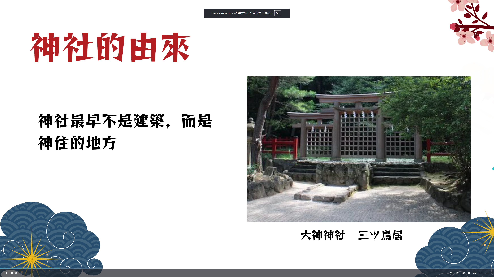
最初並沒有固定的建築物，人們只是在聖地圍起石頭或繫上草繩作為神靈降臨的依據來進行祭祀。
隨著社會發展與建築技術進步，人們開始模仿農舍或高床式倉庫，建造永久性的房屋來供奉神明，這才逐漸演變成今日所見的「神社」樣貌。
大神神社位於日本奈良縣，被公認為日本最古老的神社之一。
神社內不設本殿，人們隔著「三ツ鳥居」將整座三輪山視為神體來祭拜。

那這也是為什麼我們常看到神社都蓋在山裡面

1.外部的入口標誌
- 鳥居
- 參道
- 狛犬

2.淨化、儀式設施
- 手水舍

3.核心社殿（神域建築）
- 拜殿
- 幣殿
- 本殿

4. 辦公與服務設施
- 社務所

周圍
圍籬或柵欄
- 玉垣 較外圍的區域 區隔參拜動線與周遭環境
- 瑞垣 最內側保護最核心的本殿
- 鎮守之森

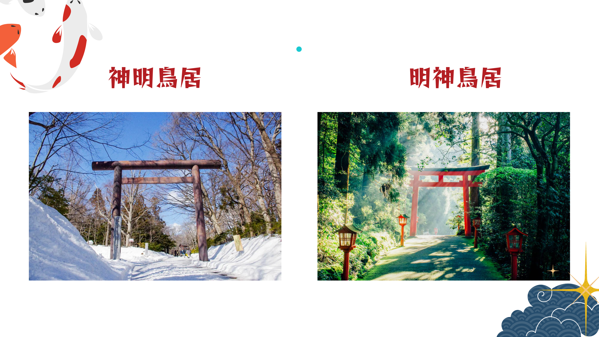
由來
根據《古事記》記載，太陽神「天照大神」因不滿弟弟的惡作劇而躲進山洞「天岩戶」，世界頓時陷入黑暗。其他神明為了吸引她出來，建造了一個高木架並放上公雞使其鳴叫。這個「讓鳥棲息的木架」就是鳥居的雛形。

神明鳥居
日本最古老、最基本的鳥居設計
笠木筆直、沒有島木
純粹的直線造型就是其最大的特色

明神鳥居
現代最常見的鳥居

佛教寺院建築風格影響（神佛習合）演變而來
笠木兩端上翹、下面多一根島木
柱子微微向內傾、中間有額束
華麗的朱紅色（具備驅魔與防腐功能），或是有著黑色基座的裝飾

核心作用都是相同的：作為劃分神域（神明居住的世界）與俗世（人類世界）的「結界」與通道。
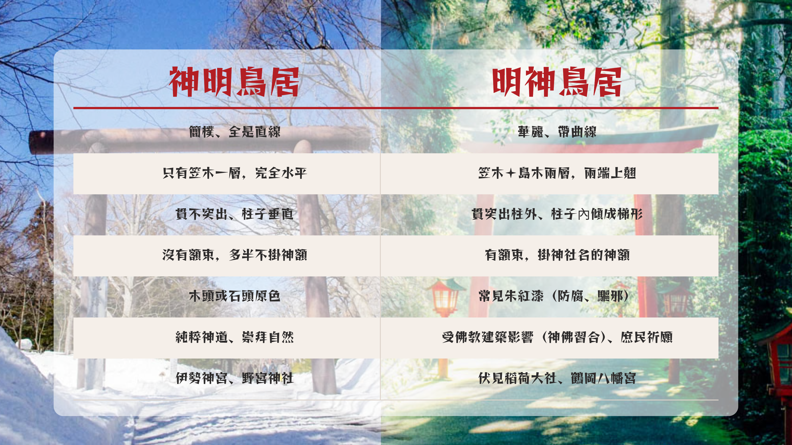

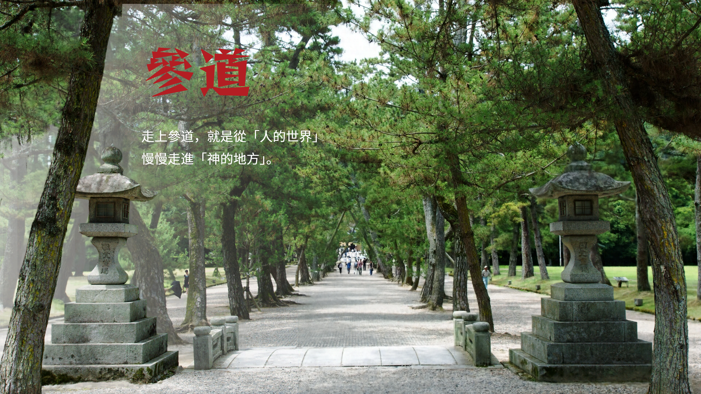

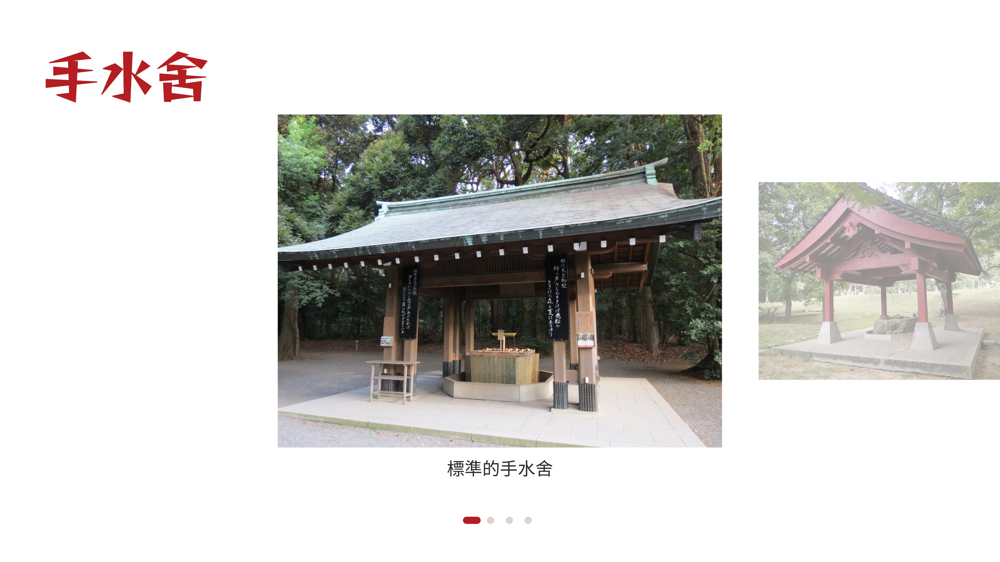

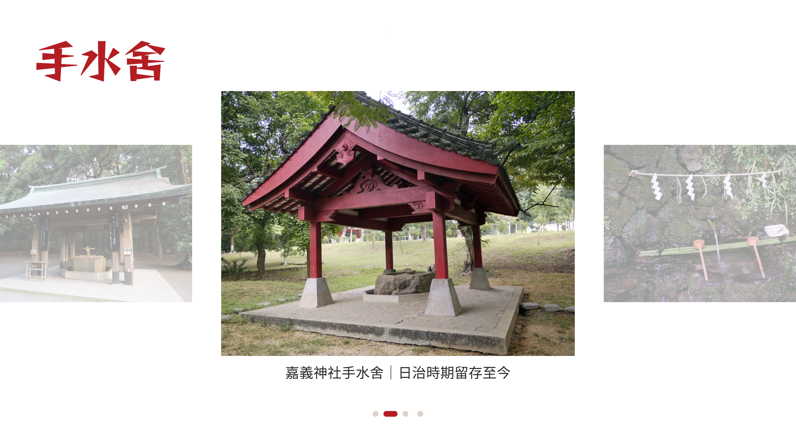

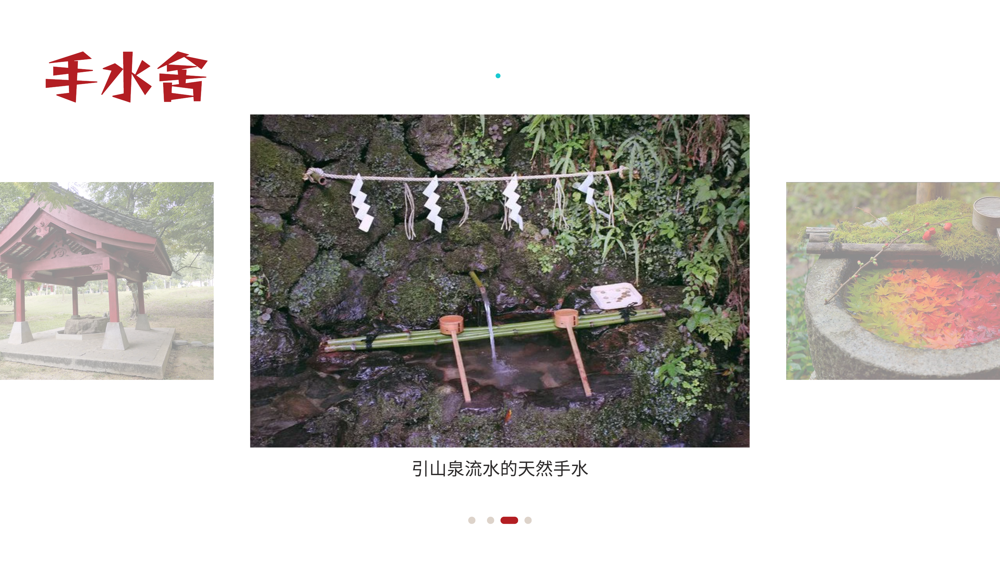

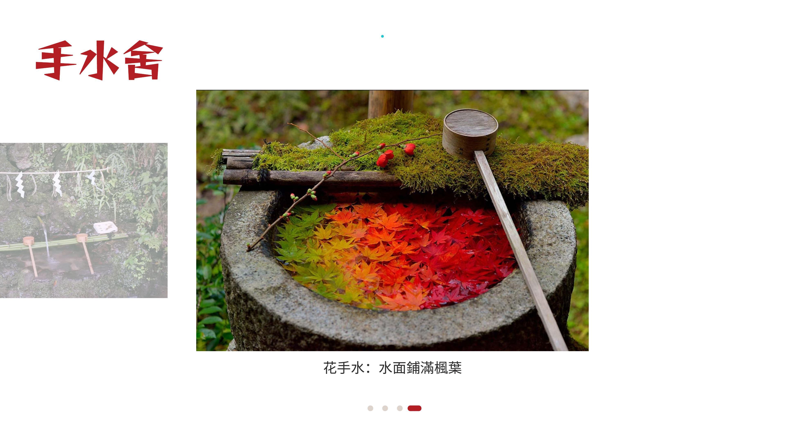

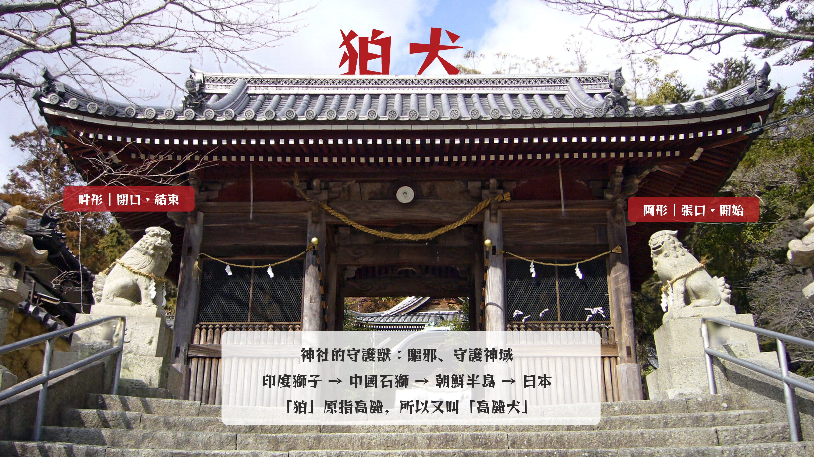

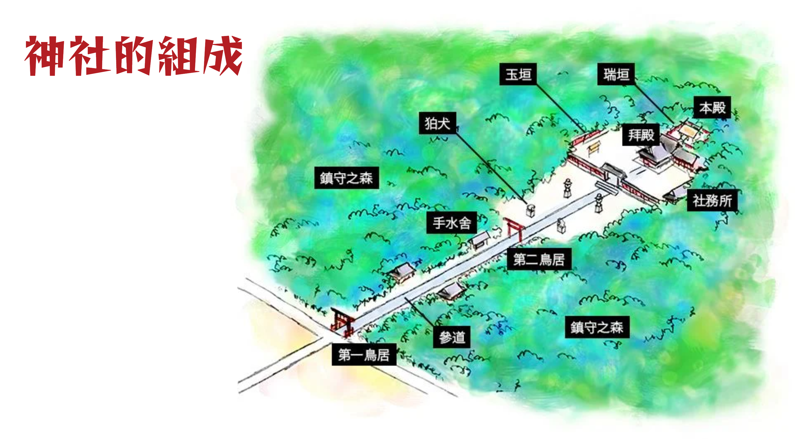

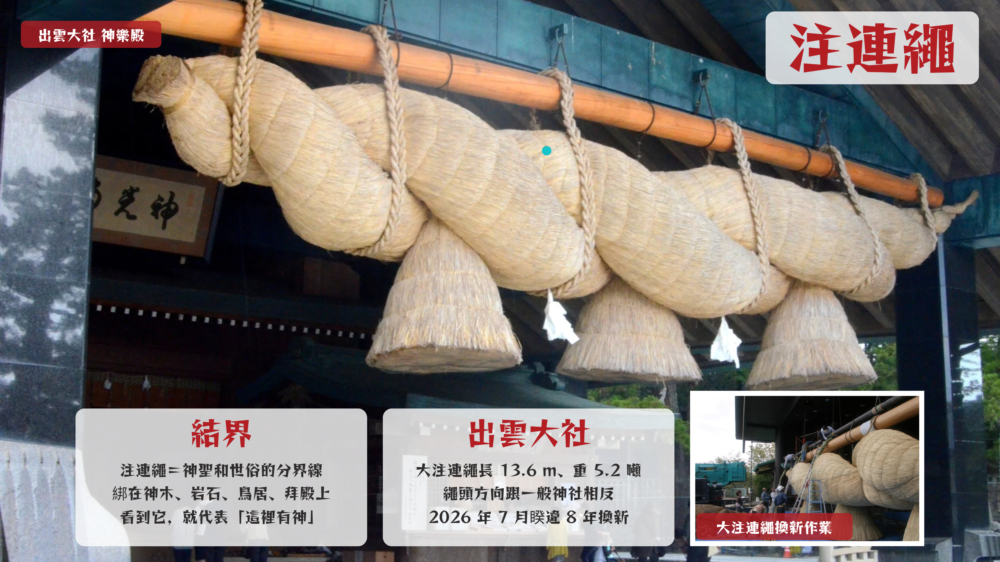

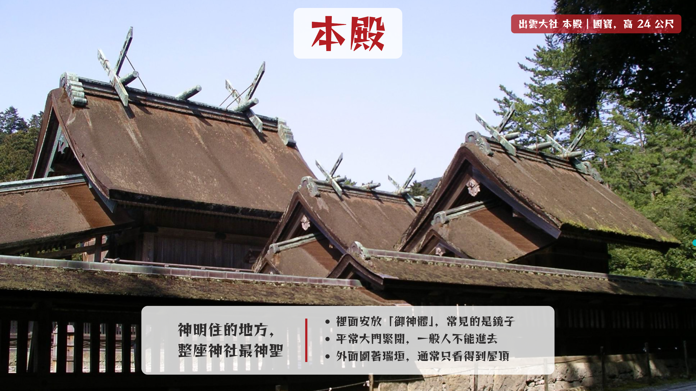

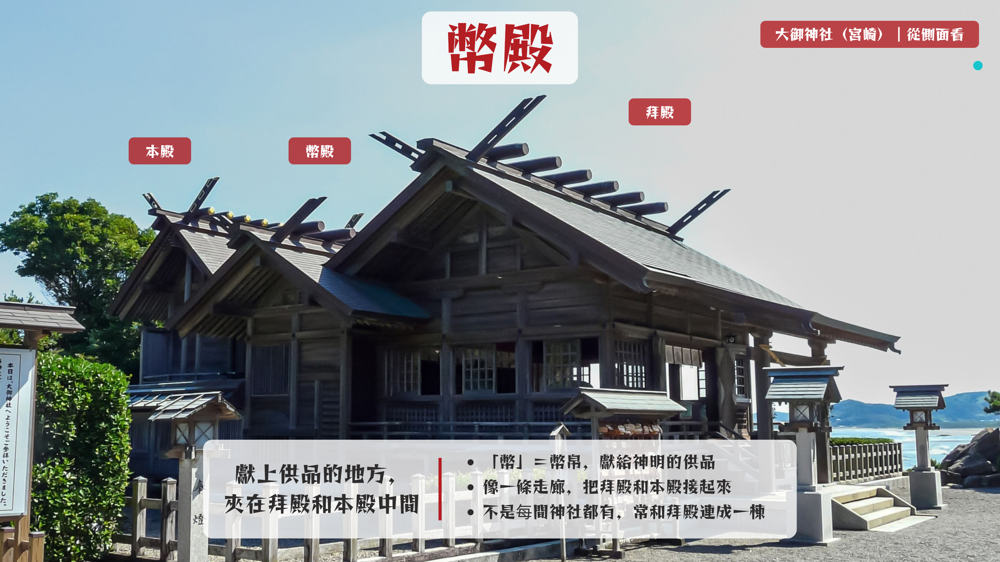

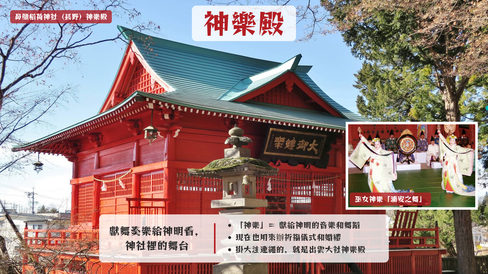

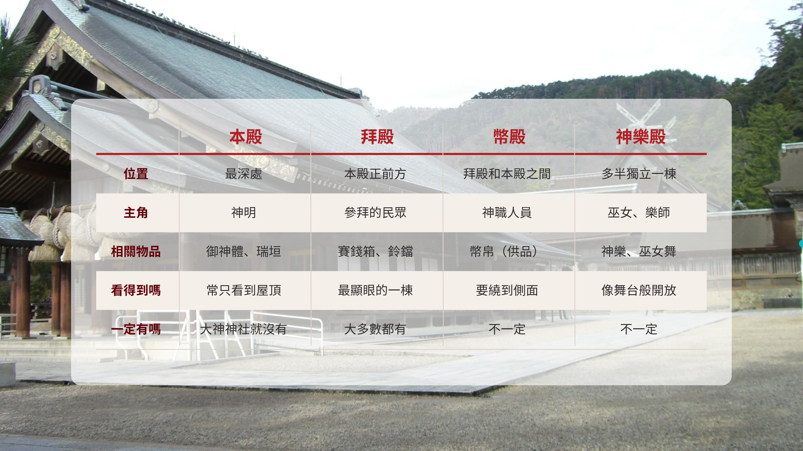